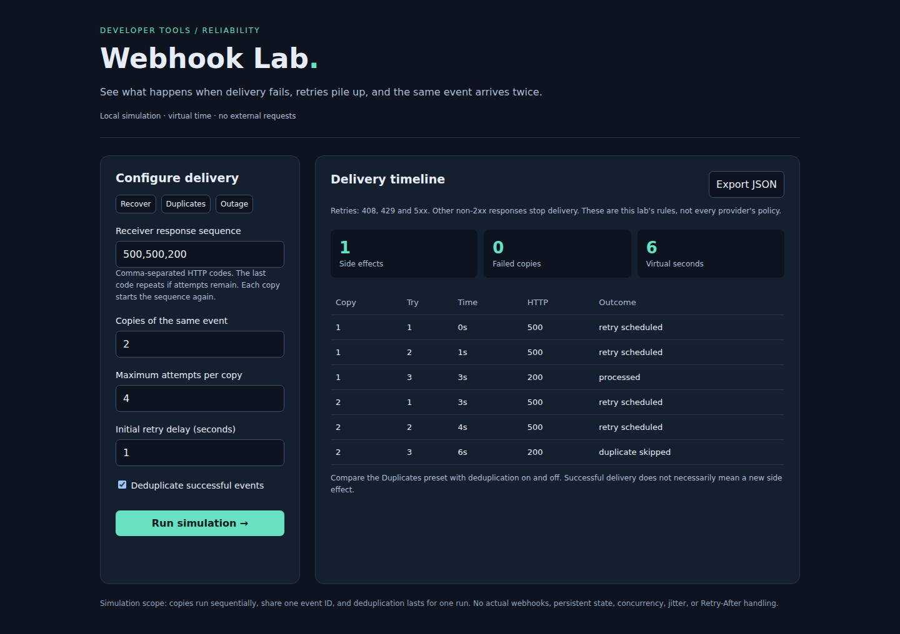

# Webhook Lab

A local playground for understanding webhook retries and duplicate processing. Configure a receiver response sequence, deliver several copies of one event, and export every simulated attempt as JSON.

Webhook receivers often see the same event more than once. This tool makes it easy to explore how retries and deduplication affect the number of business operations a receiver performs.

## Demo



[Watch or download the recorded walkthrough (MP4)](docs/demo.mp4)

The recording runs the actual Python server and browser UI. It shows recovery after failures, duplicate deliveries with deduplication enabled and disabled, retry exhaustion, and JSON export. Time in the delivery table is simulated; the walkthrough does not send webhooks to external services.

## Run

Python 3.11 or newer. No third-party packages or credentials required.

```sh
git clone https://github.com/maliabbas101/webhook-lab.git
cd webhook-lab
git checkout feat/local-playground
python lab.py
```

Open http://127.0.0.1:8000. The server binds to localhost; this is a local demo, not a production webhook receiver.

```sh
python -m unittest -v
```

## Try it

1. Run `500,500,200` to see recovery after exponential backoff.
2. Run the Duplicates preset with deduplication enabled: two successful deliveries produce one side effect.
3. Disable deduplication and rerun: the same deliveries produce two side effects.
4. Run `503` to exhaust the retry budget. Export the log for comparison.

## Model

Each copy starts the configured status sequence from the beginning. When the sequence ends, its final status repeats. Any 2xx response is acknowledged; 408, 429 and 5xx responses retry up to the attempt budget. Other statuses stop the copy. Retry delays are `initial_delay * 2 ** (attempt - 1)` and advance virtual time without sleeping.

Copies execute sequentially and share a single event identity. Deduplication records successful processing for the duration of one simulation. This makes the difference between acknowledgements and side effects visible. It does not model concurrent duplicate races or guarantee exactly-once processing in a real system.

`POST /api/simulate` accepts `statuses`, `copies`, `attempts`, `delay`, and `deduplicate`. `GET /health` provides a health check.

Example request:

```sh
curl http://127.0.0.1:8000/api/simulate \
  -H 'Content-Type: application/json' \
  -d '{"statuses":[500,500,200],"copies":2,"attempts":4,"delay":1,"deduplicate":true}'
```

This produces six attempts, one side effect, zero failed copies, and six virtual seconds. [Example outage report](docs/sample-report.json) shows the exported format.

## Record the demo again

Node.js 22 is needed only for browser checks and recording, not for running the app. Keep the Python server running in another terminal, then run:

```sh
npm install --no-save playwright@1.58.2
npx playwright install chromium
node scripts/record-demo.cjs
```

On Linux, use `npx playwright install --with-deps chromium` if browser system dependencies are missing. The script checks recovery, deduplication, retry exhaustion, JSON download and mobile overflow, and writes the recording and screenshots to `docs/`. The same steps run in the [recording workflow](https://github.com/maliabbas101/webhook-lab/actions/workflows/demo.yml).

## Limits and next steps

This version simulates delivery rather than sending network traffic. State is not persisted. It does not implement signatures, jitter, Retry-After, provider-specific policies, or real endpoint replay. A real receiver would need durable idempotency storage and atomic handling of business side effects. No employer code or patient data is included.

No hosted demo is deployed yet. Run locally using the commands above.
